# 首页入口收纳与模块化改造路线图（2026-11-01）

对象：`https://feida.au/en/` 与 `/zh/`，以及被全站共用的顶栏。
参考：`anthropic.com` 首页（顶栏分组、三张公告卡、Learn more 图卡、卡片 `···` → Related articles 分支树、View more → `/search?topic=`）。

本文件只做方案，不改线上代码。所有截图在 `shots/`，可交互原型在 `mock/`（直接双击 `mock/home.html` 打开；加 `?lang=zh` 看中文，`?menu=1` 看手机菜单，`?related=observatory` 看 Related 弹层）。

---

## 0. 结论先行

1. 首页只有 9 个目标页面，却被列了 24 次：顶栏 10 处、正文 10 处、页脚 7 处。中英文版结构完全一致，所以冗余也一致。
2. 顶栏 7 个一级入口 + 1 个下拉，Anthropic 是 4 + 2。**已定：收成 5 个一级：Analysis ▾ · Courses · Serials · Labs ▾ · About**（分析 / 课程 / 连载 / 实验室 / 关于），每个页面仍然 2 次点击内可达。
3. 正文「Latest work」「A field note」「About me」「Find your way in」四个区块全部是导航的重复表达。建议合并为 Anthropic 式的两层：**3 张「最新」卡片** + **4 张「了解更多」图卡**，删掉「Find your way in」。
4. 「Related articles」和「topic 专题页」是真正的新能力，需要一份全站内容索引。它们放在第三阶段，前两阶段不依赖它。
5. 仓库里早已存在分组的数据模型（`siteManifest.js` 的 `nav.group: 'labs'` 和 `HOME_NAV_GROUPS`），而且 10 月初做过一版「Portfolio · Markets · Learn · Stories · More」的折叠顶栏（`docs/global-menu-evidence/menu-more-980.png`），后来被摊平了。这次是把那条线重新捡起来，不是从零开始。

---

## 1. 现状审计

### 1.1 截图

| | 桌面 1440 | 手机 390 |
|---|---|---|
| EN | 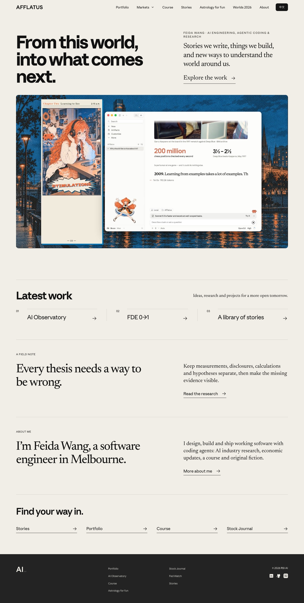 | 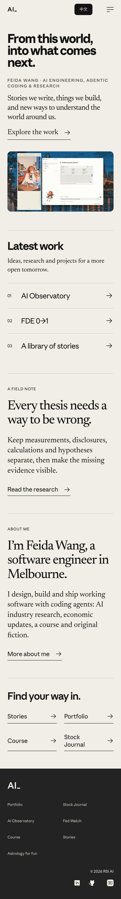 |
| ZH | 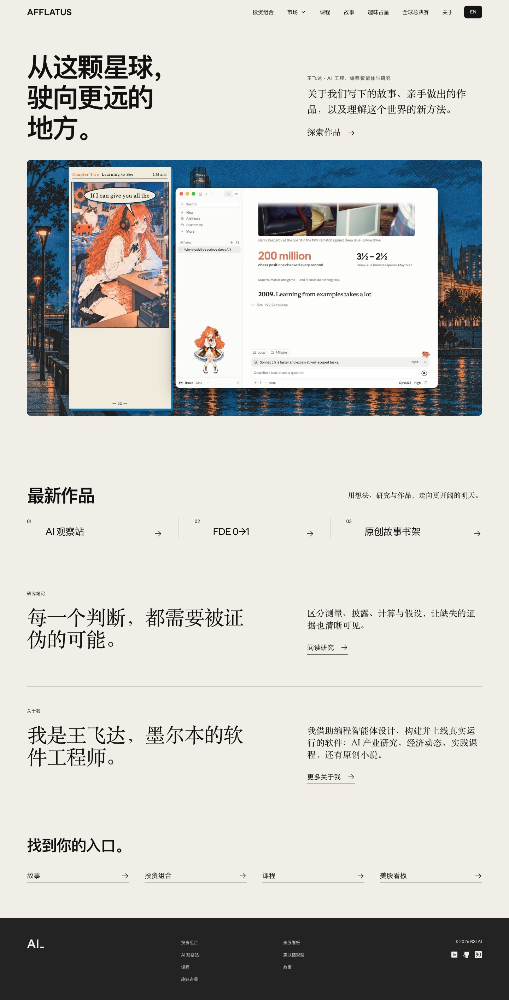 | 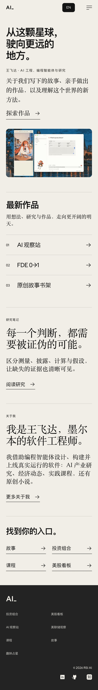 |

手机菜单展开（EN）：

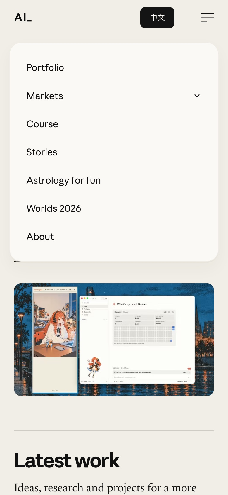

### 1.2 入口清点（index.html，中英同构）

| 位置 | 入口数 | 内容 |
|---|---|---|
| 顶栏一级 | 7 | Portfolio · Markets ▾ · Course · Stories · Astrology for fun · Worlds 2026 · About |
| 顶栏下拉 | 3 | Stock Journal · AI Observatory · Fed Watch |
| Hero | 1 | Explore the work → Portfolio |
| Latest work | 3 | AI Observatory · FDE 0→1 · A library of stories |
| A field note | 1 | Read the research → sectors#sources |
| About me | 1 | More about me → About |
| Find your way in | 4 | Stories · Portfolio · Course · Stock Journal |
| 页脚 | 7 | 缺 Worlds 2026 与 About，与顶栏不一致 |
| **合计** | **27 个链接 → 9 个页面** | |

### 1.3 具体问题

- **「Find your way in」是 100% 重复**：4 个入口全部在顶栏和页脚里。删除后没有任何页面失去入口。
- **「Latest work」是导航的另一种排版**：3 个条目都是顶栏一级入口，且没有日期、摘要、状态，不传达「最新」。
- **两段 essay（Field note / About me）本质是两张卡片**，但用了与 Hero 同级的大字排版，视觉权重高于内容权重。
- **顶栏一级入口过长**：「Astrology for fun」「Worlds 2026」两个娱乐性、季节性的页面占了一级位置，和 Portfolio、Course 平级。
- **手机菜单是 7 行平铺**（见上图），没有层级，也没有任何内容预览。
- **页脚与顶栏不同步**：页脚少了 Worlds 2026 和 About，说明入口是手工维护的，没有单一来源。
- **中英文没有差异化问题**：两版结构一致，只需改一次模板（`src/lib/sharedHeader.js` 由 `scripts/shared-header.mjs --write` 注入全部页面）。

---

## 2. Anthropic 参考模式拆解

| 模块 | 截图 | 可迁移的点 |
|---|---|---|
| 顶栏 | 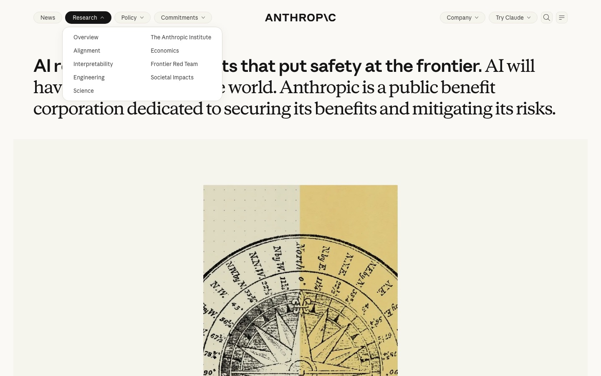 | 左 4 个分组胶囊（News · Research ▾ · Policy ▾ · Commitments ▾），中间 wordmark，右 2 个胶囊 + 搜索 + 全站菜单。下拉是白色浮卡、两栏。 |
| 首页主体 | 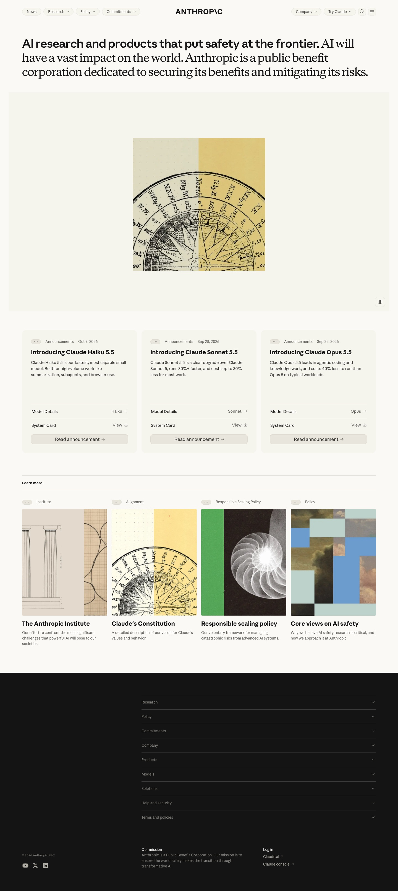 | 标题段 → 一张大媒体 → **3 张公告卡**（标签 · 日期 · 标题 · 摘要 · 两行链接 · 一个按钮）→ **Learn more 4 张图卡** → 手风琴页脚。没有「找入口」区块。 |
| 卡片 `···` → Related | 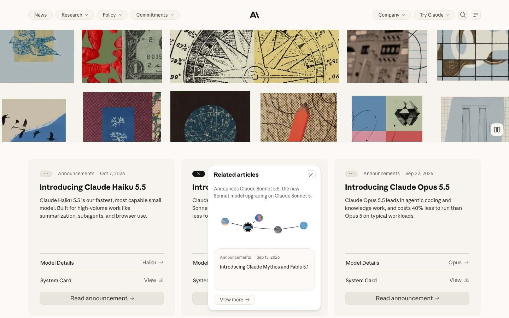 | 弹层四件套：一句话描述 · 分支树小图 · 1 张相关卡 · **View more →**。弹层覆盖在卡片之上，不跳页。 |
| Learn more 卡的 Related | 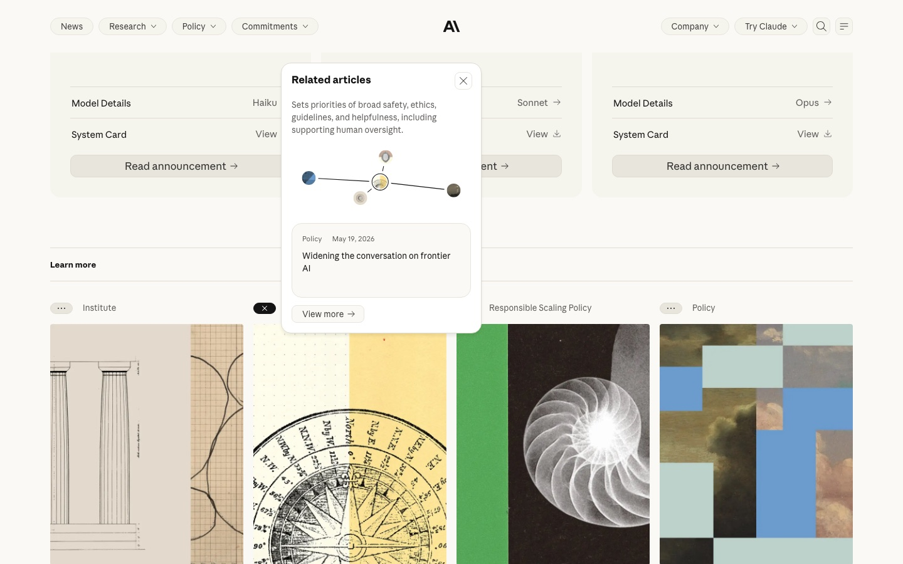 | 同一套弹层组件复用于图卡。 |
| View more → 专题页 | 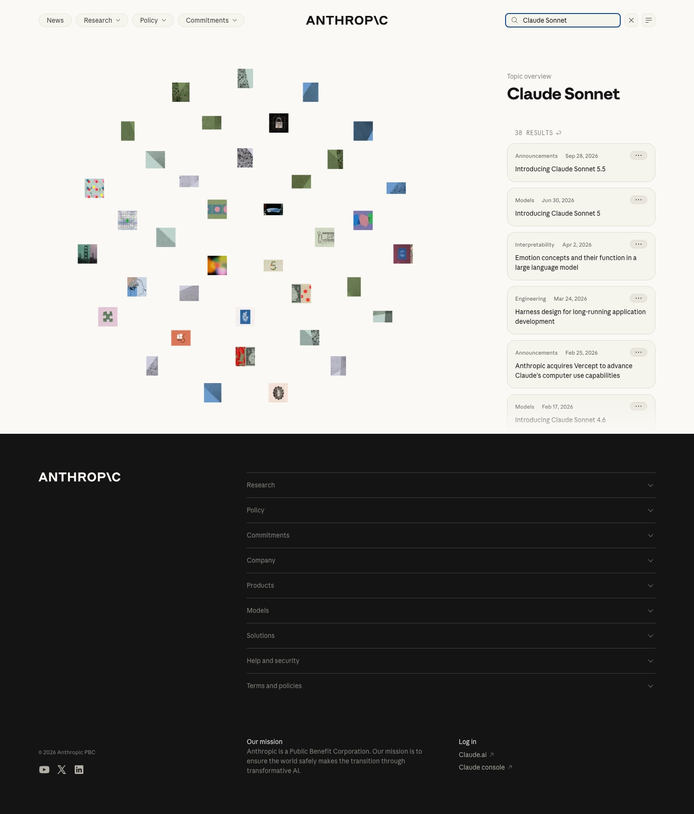 | `/search?topic=claude-sonnet`：左侧封面马赛克，右侧「Topic overview / 标题 / N RESULTS / 结果卡列表」，每张结果卡也带 `···`。 |
| 手机菜单 | 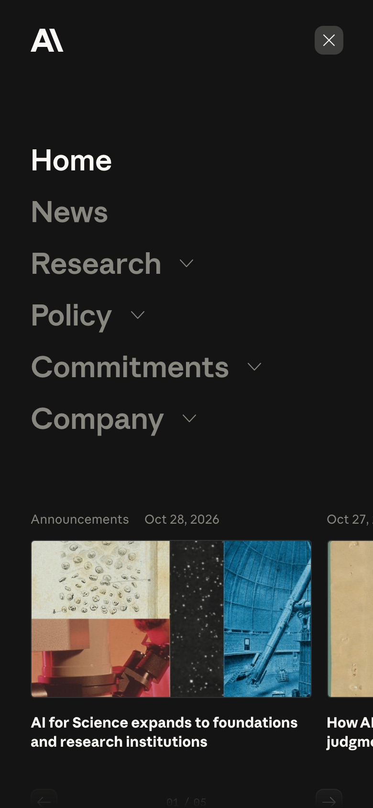 | 全屏深色，大字分组列表，底部一条「最新」横向卡片轮播。菜单本身就是一个入口页。 |

---

## 3. 目标信息架构

**2026-11-01 已敲定：**

```
AFFLATUS
├─ Analysis ▾  分析    Portfolio 投资组合 · Stock Journal 美股看板 · Fed Watch 美联储观察 · AI Observatory AI 观察站
├─ Courses     课程    /course.html（FDE 0→1，单链接）
├─ Serials     连载    /zh/serial.html（玉熙宫词，单链接）
├─ Labs ▾      实验室  Astrology 趣味占星 · Worlds 2026 全球总决赛
└─ About       关于
```

- 一级入口 7 → 5，下拉 1 → 2，每页仍 ≤ 2 次点击。
- 分组落在 `siteManifest.js` 的 `nav.group` 字段上：现有值 `labs` 保留，新增 `analysis`；`course / serial / about` 不分组。顶栏、手机菜单、页脚从同一份数据渲染，解决页脚不同步。
- Worlds 2026 赛季内不提到一级，靠首页「了解更多」的 Worlds 卡和 Labs 下拉导流。
- Courses / Serials 目前各只有一项，先做单链接；将来第二门课 / 第二部连载出现时再改成下拉，数据模型已支持。

---

## 4. 模块与原型

### M1 · 顶栏折叠

**方案 A（推荐，第一阶段）**：保留现有几何（左 wordmark、右侧文字导航、黑色语言按钮），只把 7 个入口收成 5 组，下拉加一列灰色副标签（FY25/26 · Daily · Macro · Sectors）。**已定为 P1 方案。** 下方截图仍是敲定前的 Markets / Learn 命名，实施时按 §3 的 Analysis / Courses / Serials / Labs / About。改动范围只在 `sharedHeader.js` + `siteManifest.js`，现有 e2e（`shared-header-prepaint`、`localized-navigation`、`quality-gates`）和 `header:check` 直接复用。

| EN · Markets 展开 | ZH · 研习 展开 |
|---|---|
| 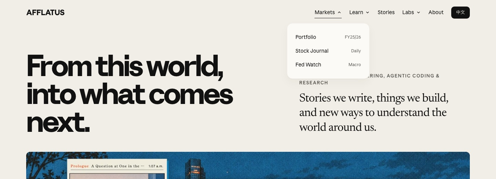 | 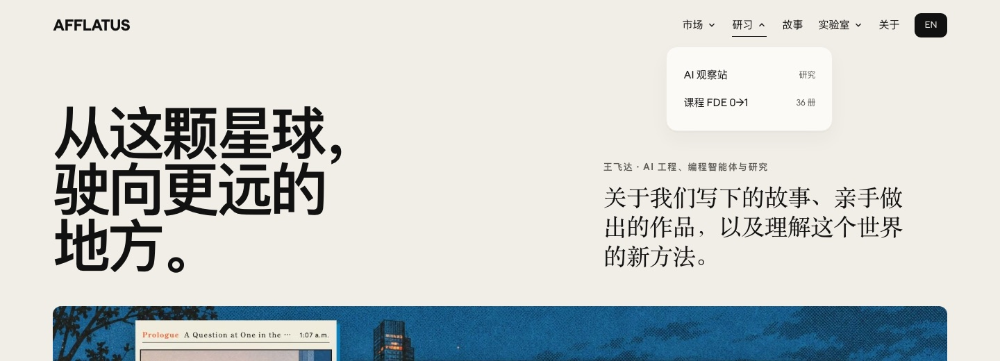 |

**方案 B（Anthropic 直译）**：胶囊分组、wordmark 居中、右侧 About · 语言 · 搜索 · 全站菜单。更像参考，但是全站 10 个页面的 header 几何都要重做，`course-chrome.css` 等页面级覆写也要跟着动。**已定：记录在案，排在 P4，时间未定。** 届时搜索框直接落到 `/search.html?q=`，与 P3 的专题页同一个页面。

| EN · Learn 展开 | ZH · 市场 展开 |
|---|---|
| 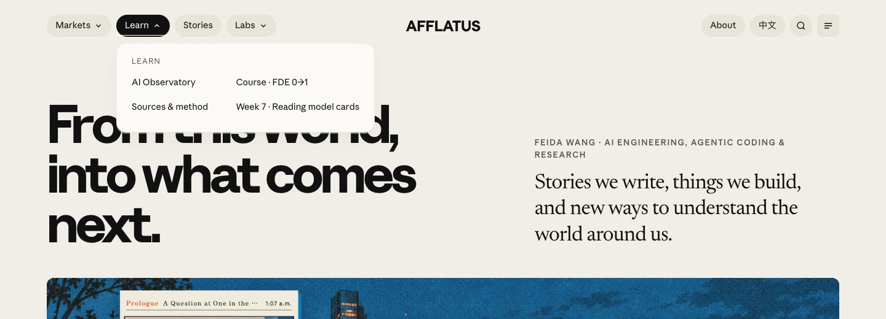 | 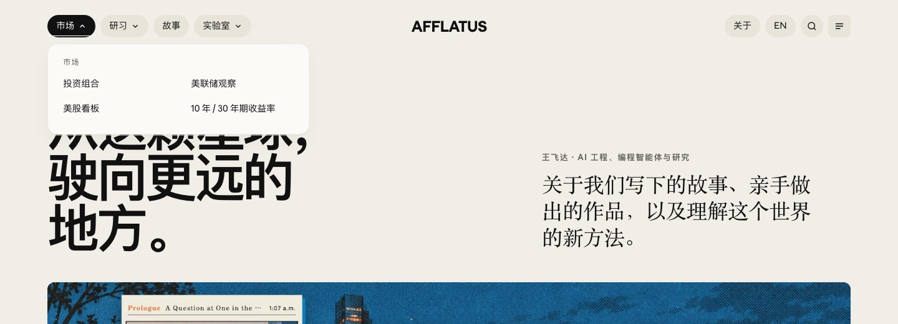 |

### M2 · 首页主体：3 张「最新」卡 + 4 张「了解更多」图卡

替换 Latest work / Field note / About me / Find your way in 四个区块。Hero 和影片不动。

| EN 桌面 | ZH 桌面 |
|---|---|
| 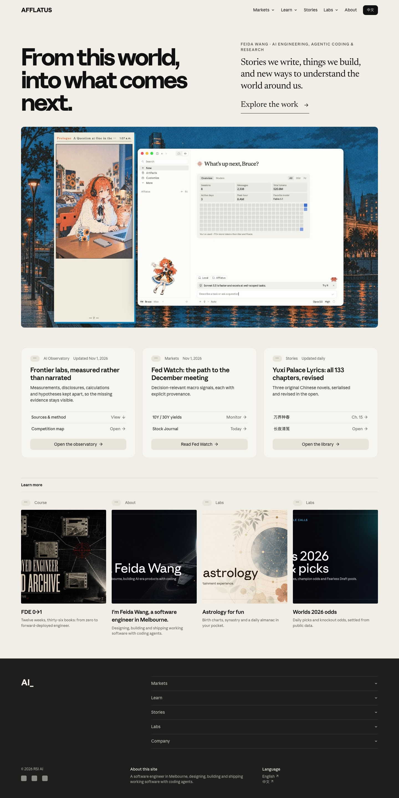 | 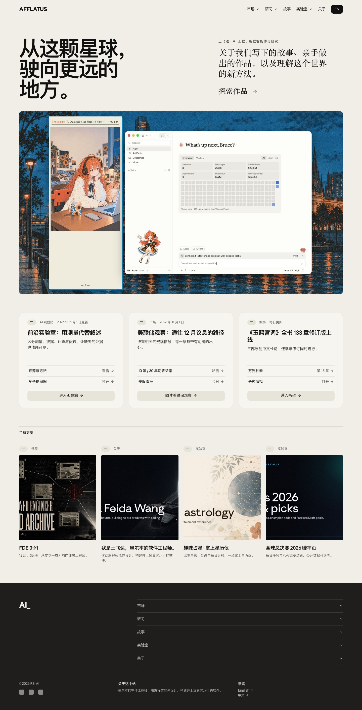 |

| EN 手机 | ZH 手机 |
|---|---|
| 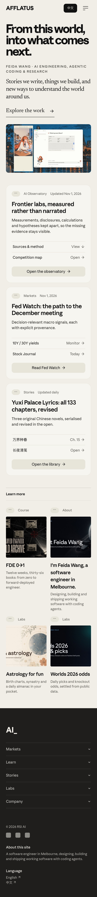 | 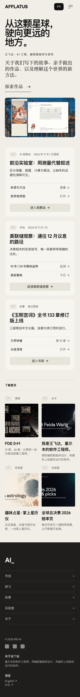 |

卡片结构（与 Anthropic 一致，便于后续挂 Related）：

```
[···] 标签 · 日期
标题（2 行以内）
摘要（2–3 行）
─ 行链接 1 ………… 动作 →
─ 行链接 2 ………… 动作 →
[ 主按钮 → ]
```

- 「最新」三张卡的内容来源：AI 观察站（`sectors-data.json` 的 updated）、市场（`signal-events.json` 的最新一条）、故事（`novels-index.json` 的 updateNote）。日期是真实数据驱动，不是手写。
- 「了解更多」四张：课程 · 关于 · 趣味占星 · 全球总决赛。原 About me essay 的文案进入「关于」卡，Field note 的文案进入观察站卡摘要。
- **原型里的图卡封面用的是现有 OG 图（带文字），正式实现需要为 4 张卡各出一张 1 : 1.1 的无文字封面**，这是一项独立的美术工作。

### M3 · 卡片 `···` → Related 弹层

| EN | ZH |
|---|---|
| 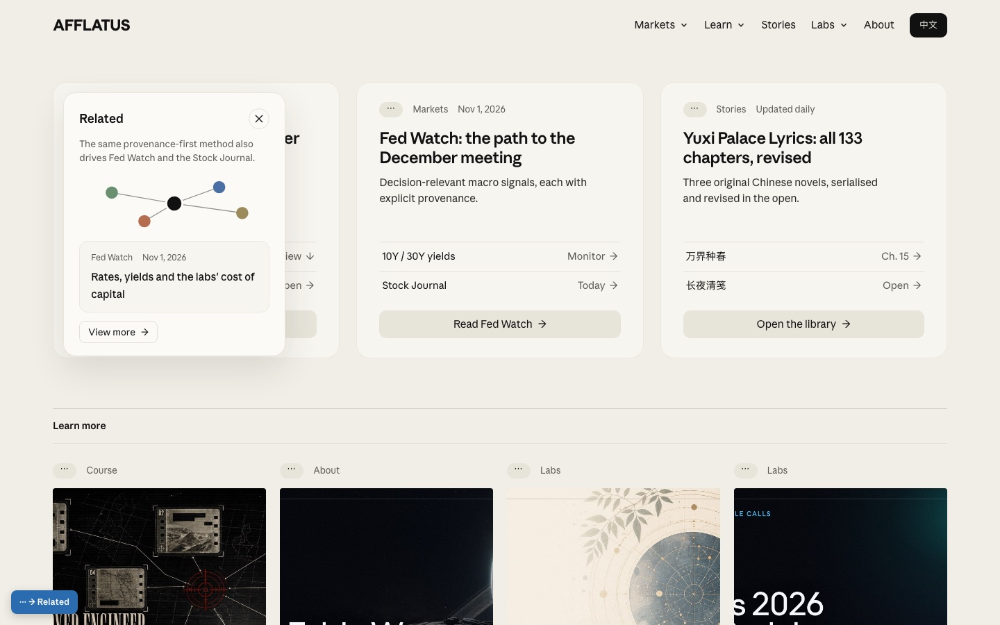 | 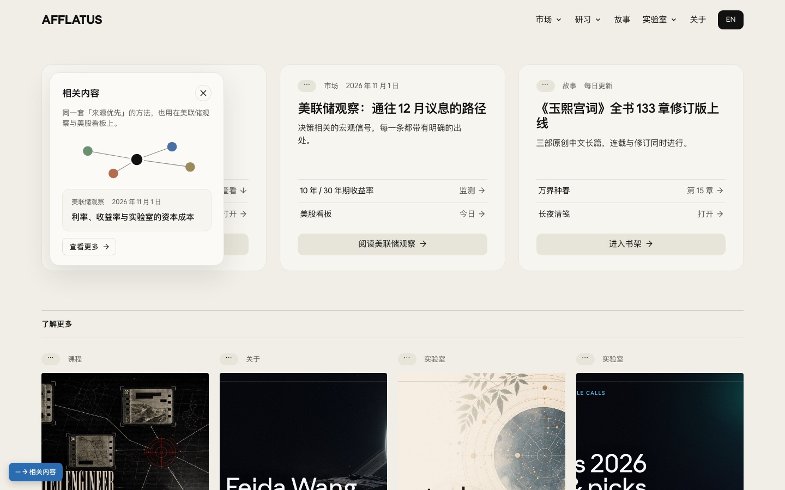 |

- 弹层四件套：一句话关系说明 · 分支树（中心 = 当前卡，4 个叶 = 相关项，用各板块的主题色）· 1 张相关卡 · 「查看更多 →」。
- 数据来源：新建 `public/topics-index.json`，由 `scripts/site-manifest.mjs` 生成，条目 = 9 个页面 + 36 本课程书 + 3 部小说 + 观察站的 4 个子区块（sources / competition / ecosystem / rivalry），每条带 `topic[]`、`date`、`title.{en,zh}`、`href`。
- 分支树只是装饰性 SVG，节点数 = 相关条目数（上限 5），不需要布局算法。

### M4 · 专题页 `/search.html?topic=ai-observatory`

| ZH 桌面 | ZH 手机 |
|---|---|
| 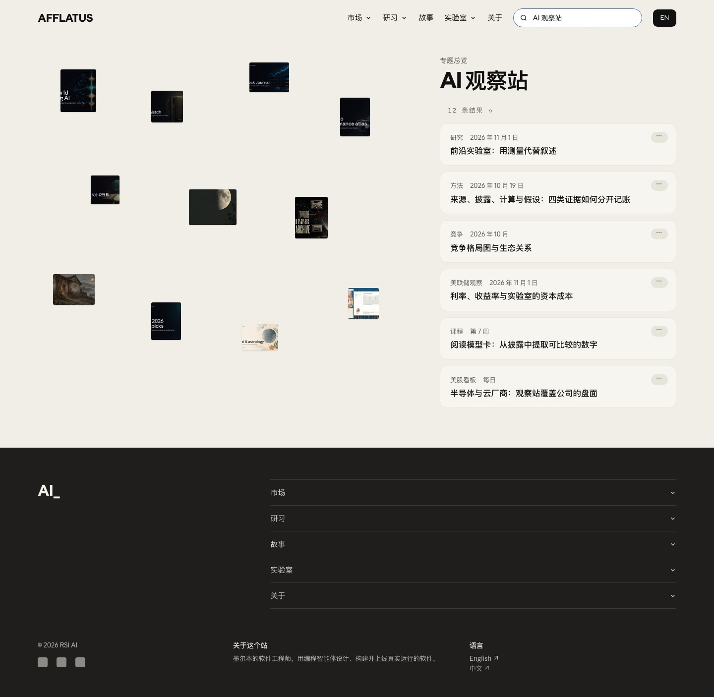 | 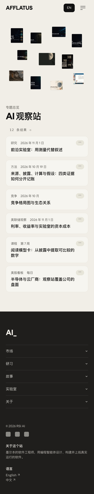 |

- 静态页 + 读 `topics-index.json` 客户端渲染，与现有 vite 多页结构一致，不需要后端。
- 左侧马赛克 = 该专题下条目的封面缩略图（随机散点，桌面 11 张、手机 11 张缩放 0.7）；右侧 = Topic overview · 标题 · N 条结果 · 结果卡（带 `···`，复用 M3 弹层）。
- 顶栏出现一个已填入专题名的搜索框（原型用的是方案 A 顶栏 + 搜索框；手机端搜索框隐藏，专题名在正文标题里）。
- URL 已定为 `/search.html?topic=`，将来站内搜索（`?q=`）复用同一页面，不换地址。

### M5 · 手机全屏菜单

| EN | ZH |
|---|---|
| 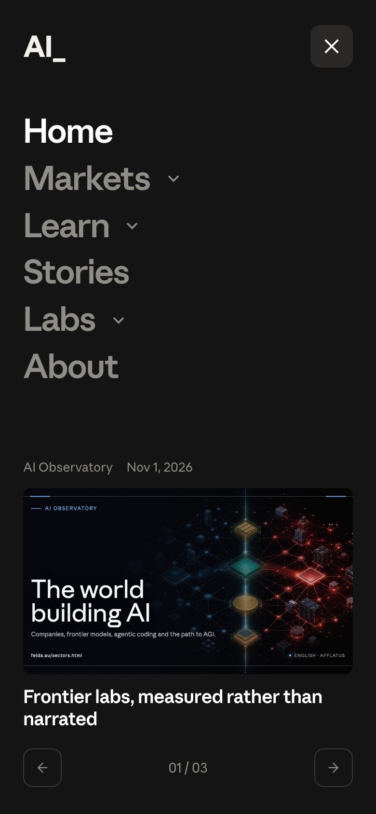 | 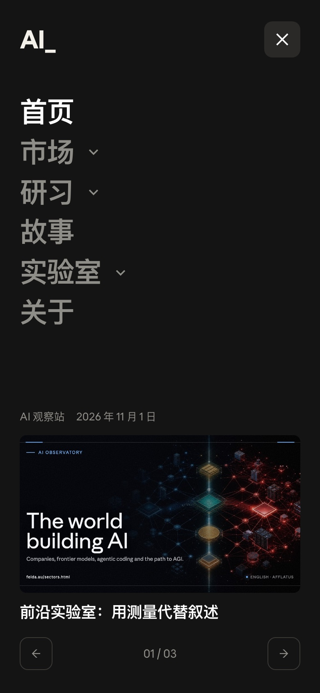 |

- 深色全屏，5 组大字（当前页白色，其余灰色），底部一条「最新」卡片（复用 M2 的卡数据），左右翻页。
- 与现在的米色下拉卡片相比，这是风格上的大转向，**需要你单独拍板**。保守做法是保留米色卡片、只改成 5 组可展开。

### M6 · 手风琴页脚

见 M2 截图底部。页脚从 7 个散链接改成 5 组手风琴 + 「关于这个站」+ 语言切换，与顶栏同一数据源。保留全部页面链接以维持爬虫路径。

---

## 5. 分阶段路线

| 阶段 | 模块 | 改动文件 | 验证标准 |
|---|---|---|---|
| **P0 基线** | 审计 | 无 | 记录现状链接数（27→目标 ≤ 18）、Lighthouse 基线（`lighthouse-baseline.json`） |
| **P1 顶栏折叠（方案 A）** | M1 + 手机菜单分组 | `src/config/siteManifest.js`（portfolio/arena/sectors/signal 加 `group: 'analysis'`，horoscope/worlds 保持 `labs`，course/serial/about 去掉 group）、`src/lib/sharedHeader.js`、`public/styles/shared-header.css`（下拉副标签）、`npm run site:generate` 回写 10 个页面 | `npm run header:check`、`tests/sharedHeader.test.js` 更新快照、e2e `shared-header-prepaint` / `localized-navigation` / `quality-gates` 全绿；390 px 菜单无横向滚动 |
| **P2 首页主体** | M2 + M6 | `index.html`、`src/showcase/premiere.css`、页脚模板（`shared-footer.css` 及各页脚 HTML）；`scripts/site-manifest.mjs` 新增「最新三卡」生成步骤（读 `sectors-data.json` updated / `signal-events.json` 最新事件 / `novels-index.json` updateNote，回写 index.html 的日期与摘要）；新增 4 张 1:1.1 无文字封面 `public/assets/home/learn-{analysis,courses,serials,labs}.webp`（P2 开工前先出图） | 首页链接数 ≤ 18 且 9 个页面仍全部可达；`lint:i18n` 通过（所有新文案带 data-en/data-zh）；`linkcheck` 通过；Lighthouse 不低于基线 |
| **P3 Related + 专题页** | M3 + M4 | `scripts/site-manifest.mjs` 生成 `public/topics-index.json`；新组件 `src/showcase/RelatedPopover.jsx`；新页 `search.html` + `src/pages/search/`；`vercel.json` 加 `/en/search.html` `/zh/search.html` 路由 | 单测：索引生成对 234 条 sitemap URL 的覆盖率 100%；e2e：点 `···` 弹层出现、Esc 关闭、焦点回到按钮；专题页 `?topic=` 非法值显示空态 |
| **P4 可选（时间未定）** | M5 深色全屏菜单 + 最新轮播、方案 B 顶栏、站内搜索 `?q=` | 同 P1 文件 + `search.html` 加查询模式 | 单独立项，前三阶段不依赖 |

每个阶段独立一个分支与 PR，P1 完成即可上线，不必等 P2/P3。

---

## 6. 决定记录（2026-11-01 站主敲定）

| # | 事项 | 决定 |
|---|---|---|
| 1 | 顶栏方案 | **A** 先上；B 记录在案，排 P4，时间未定 |
| 2 | 分组命名 | **Analysis / Courses / Serials / Labs / About**，中文 **分析 / 课程 / 连载 / 实验室 / 关于** |
| 2b | 页面归属 | Analysis ▾ = Portfolio · Stock Journal · Fed Watch · AI Observatory；Courses、Serials 单链接；Labs ▾ = Astrology · Worlds 2026 |
| 3 | Worlds 2026 | 收进 Labs，不提一级；首页「了解更多」给一张卡 |
| 4 | 首页瘦身 | 全删「Find your way in」「A field note」「About me」，文案并入卡片 / About 页 |
| 5 | 「最新」卡数据 | 数据驱动：日期与摘要由构建脚本从三份 JSON 读取 |
| 6 | 手机菜单 | 深色全屏 + 最新轮播（M5），放 P4；P1 先在现有米色菜单里按 5 组分段 |
| 7 | 图卡封面 | 新出 4 张 1:1.1 无文字封面，P2 开工前准备 |
| 8 | 专题页 URL | `/search.html?topic=`，为站内搜索留位 |
| 9 | 「了解更多」四张卡 | 按页面：课程 · 关于 · 趣味占星 · 全球总决赛（§4-M2）；课程、关于、占星封面由站主提供，全球总决赛封面用 Figma 重画（Faker 配乐芙兰、Chovy 配永恩），存为 `public/assets/home/learn-{courses,about,astrology,worlds}.webp`，取代 §5 的按分组写法 |
| 10 | 「≤ 18 链接」口径 | 只算顶栏导航和正文：顶栏 9 + Hero 1 + 7 张卡各 1 个链接 = 17，页脚另计；因此不做 §4-M2 卡片结构里的两条行链接 |
| 11 | Related 分支树（2026-11-02） | 分支树 = 同专题时间线：中心是当前卡，分支是同专题按日期倒序的最近 5 条，每条标日期和短标题、可点击，其余由「查看更多」兜底；专题页结果同样倒序。历史从数据文件自动提取，更新数据后树自动增长，不造日期；事件直接作为索引条目 |
| 12 | 专题页封面（2026-11-02） | 马赛克只取本专题条目的封面；没有专属封面的 8 条（观察站 4 个子节、Portfolio、课程指南 / 手册 / 来源库）由图卡封面的同一生成工具补齐 1:1.1 无文字封面，存到 `public/assets/topics/` |
| 13 | 分支树样式（2026-11-02） | 选方案 A：左侧根节点，曲线分到右侧最多 5 张小卡（日期 + 一行标题），整张小卡可点；手机端结构相同。键盘操作、Esc 关闭、焦点回按钮不变 |
| 14 | 分支深链（2026-11-02） | 节点直达具体内容：Fed Watch `/signal.html#<事件 id>`、观察站 `/sectors.html#event-<id>`、课程到对应 book 页、小说到作品首页（2026-11-05 改：原先跳最后一章，从关联树点进去会直接看到结尾）。到达后展开折叠、滚到该条并高亮约 3.5 秒 |
| 15 | 专题页分页（2026-11-02） | 先显示 10 条，「加载更多」每次再展开 10 条；条数和马赛克仍按全部条目 |
| 16 | 8 张专题封面（2026-11-02） | 风格以 P2 四张为准；当前版本先接入，是**临时版**，站主之后另行重新生成替换，不在 P3 内。第 12 条的 8 张文件名不变，替换时直接覆盖 |
| 17 | 方案 B（2026-11-02） | **不替换 A**：保留方案 A 的几何，只在语言按钮左边加搜索图标，链到 `/search.html#q` 并聚焦搜索框；B 继续留档。第 1 条「B 排 P4」到此收口 |
| 18 | P4 范围与顺序（2026-11-02） | 三项一个叠加 PR：站内搜索 → M5 → 顶栏搜索图标。第 10 条的口径因此变为顶栏 10 + Hero 1 + 7 张卡 = 18，仍在上限内 |
| 19 | M5 手机菜单（2026-11-02） | 979 px 及以下为深色全屏。5 组大字，不加 Home 行（回首页走左上 `AI_`），所以首页 5 组全灰；当前页所在组自动展开，组名和当前页白色；一次只展开一组。底部「最新」轮播复用 M2 三张卡，封面复用 `public/assets/topics/` 的 sectors / signal / serial，首次打开菜单才加载 `/lib/compact-menu.js` 和 `/menu-latest.json`，加载失败时只是不显示轮播。Esc 直接关闭整个菜单，焦点回菜单按钮；打开时页面其余部分 `visibility: hidden`，键盘和读屏都到不了。无脚本时保留原来的米色列表 |
| 20 | 站内搜索（2026-11-02） | `/search.html?q=`，只搜 `topics-index.json` 的标题和摘要，中英文都搜，每个词都要命中；标题命中的排前面，各自按日期倒序。不搜章节正文，全文搜索以后单独立项。无结果时列出全部专题；`q` 优先于 `topic`，空白 `q` 等于没有 |

P4 实拍见 `shots/p4-*.jpg`：`p4-menu-*` 手机菜单、`p4-search-*` 搜索页、`p4-header-*` 顶栏。

原型（`mock/`）与截图仍是敲定前的 Markets / Learn / Stories 命名和 `/topics.html` 地址，实施以本节为准，不再更新原型。

---

## 7. 风险

- **SEO**：首页内链从 27 降到约 18，但页脚保留全部页面链接，9 个页面的爬虫路径不变。`seo:check` 与 sitemap 不受影响。
- **全站 header**：`sharedHeader.js` 被 10 个页面共用，P1 改动会同时影响 course / serial 等页面的顶栏；`course-chrome.css` 与 `serial-header-follow.spec.js` 要一起回归。
- **双语**：所有新文案走 `data-en / data-zh`，由 `lint:i18n` 把关；Stories 仍只指向 `/zh/serial.html`。
- **性能**：Related 弹层与专题页都是按需加载 `topics-index.json`（预计 < 40 KB），不进入首屏关键路径。
