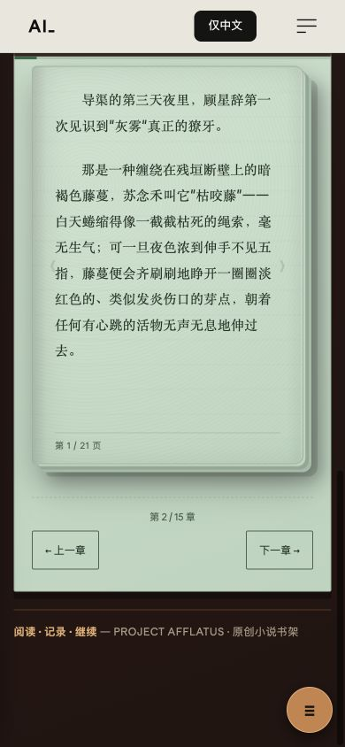
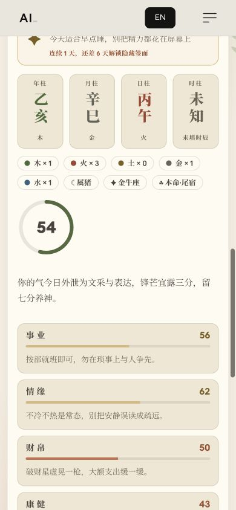

# Serial 与 Horoscope 移动体验重设计提案

实施进度：[首轮交付与待办](IMPLEMENTATION.md)。已按用户选择采用方案 1 正文、方案 3 继续阅读、方案 2 观星与夜间模式；下面保留原始提案及研究基线。

2026 年 10 月 11 日，Australia/Melbourne。状态：完成实站探索、代码抽查、资料核验入口和三组静态视觉草案；尚未实施页面、替换算法、接通邮件或部署。本文是后续实施规格，不是已交付功能清单。

建议将两个实验室设计为 AFFLATUS 的日常使用入口：Serial 是安静、可靠、可随时继续的阅读软件；Horoscope 是有出处、能记录自己生活的每日星象手记。继承当前首页的暖纸色、黑色标题、衬线叙述和留白；实验感体现在交互深度与内容质量。

## 当前页面的实测证据

本次使用 Codex 内置浏览器，桌面基准 1280×720、移动视口 390×844。未改动用户安装的浏览器。观星测试生日为虚构样例 1995-05-15，时辰与地点未知。页面已有本机阅读进度，因此阅读入口观察包含恢复状态，不代表首次访问。

| 步骤 | 观察内容 | 状态与改进重点 | 截图 |
| --- | --- | --- | --- |
| 1 | AFFLATUS 首页 | 视觉基准清楚：暖中性色、黑色大标题与编辑式排版 | [首页](01-home-desktop.jpg) |
| 2 | Serial 手机书架与恢复阅读 | 可用，但简介过长、横向书架卡片露出不完整；恢复提示出现后仍经过书架和简介 | [手机入口](08-serial-mobile-reading.jpg) |
| 3 | Serial 正文与下一页 | 翻页有效；约 2476 字的一章显示 21 页，第二页只呈现一段短对话。拟真书边、阴影与内边距压缩正文面积 | [正文](09-serial-mobile-prose.jpg)、[第二页夜间状态](11-serial-mobile-night.jpg) |
| 4 | Serial 工具与主题 | 能切夜间色；字体、翻页、音乐挤在窄小展开区域，音乐曲名主要藏在辅助标签中，单手操作和发现性不足 | [阅读工具](10-serial-mobile-tools.jpg) |
| 5 | Horoscope 首次填写 | 只填日期即可起盘是优点，但大段计算假设占据首屏；日期与补充信息挤在同一行 | [首次填写](03-horoscope-mobile-entry.jpg) |
| 6 | Horoscope 生成结果与每日查看 | 能生成三柱与每日内容；新旧结果区域叠加，部分控件显示默认按钮样式，数字分数比生活建议更显眼；友情未独立呈现 | [生成后](05-horoscope-mobile-result.jpg)、[每日详情](07-horoscope-mobile-daily-detail.jpg) |
| 7 | Co–Star 官方展示 | 单色、衬线、短句与关系分区可借鉴。此处检查的是官方网页展示，未登录原生 App | [官方展示](12-costar-official-reference.jpg) |

截图能确认密度、视觉层次与可见控件问题；不能证明完整无障碍合规、真机续航、后台音频可靠性或算法准确性。音乐未实际试听；本次没有运行完整自动化测试。自动翻页、听书与合盘全流程仍需实施阶段验证。

## 共享视觉与人体阅读需求

页面采用同一品牌外壳与各自内容节奏。全站导航保留于进入、退出和书架；沉浸阅读时收为简洁返回入口，正文不与全站导航争空间。返回时恢复焦点与滚动位置。

以下数值是初始设计参数，须以真机阅读验证调整，不代表医学上的最优值。

| 项目 | 实施规格 |
| --- | --- |
| 中文正文 | 默认 19px，允许 16–28px；行高默认约 1.85，可调 1.6–2.2；左右留白约 20–24px。宋体与清晰无衬线可选 |
| 屏幕适配 | 320、360、390、430px 与横屏分别检查；使用动态视口和安全区；软键盘出现时输入框、主按钮可见 |
| 阅读宽度 | 手机自然排版，不套固定纸张；平板与桌面约 36–42 个汉字宽，用户可调，不把英文 ch 单位等同于汉字数 |
| 配色 | 纸白、浅鼠尾草、暖灰、炭黑夜间四种候选；夜间使用柔和浅色文字。主题随系统或手选，不按日落突然切换 |
| 对比度 | 普通文字至少 4.5:1；关键正文以 7:1 为设计目标；控件边界与状态逐项验证，不能只检查正文 |
| 操作区域 | 常用触控目标 44–48 CSS px，图标配文字；这是本产品高于 WCAG 2.2 AA 最小要求的设计目标 |
| 动效 | 翻页轻移或淡入约 160–220ms，面板约 200–260ms；支持关闭。减少动态效果时去掉位移、纸张卷曲与背景运动 |
| 注意力 | 正文背后不放动画、纹理条纹或滚动视差；文字选中、批注、暂停均不触发自动翻页 |
| 视觉舒适 | 可选阅读休息提醒、字号、行距、主题与自动播放关闭。不得宣称绿色背景或低蓝光主题能保护视网膜 |

参考 [WCAG 对比度](https://www.w3.org/WAI/WCAG22/Understanding/contrast-minimum.html)、[文字间距可调整](https://www.w3.org/WAI/WCAG22/Understanding/text-spacing.html)、[触控目标](https://www.w3.org/WAI/WCAG22/Understanding/target-size-minimum.html)、[交互动效](https://www.w3.org/WAI/WCAG22/Understanding/animation-from-interactions.html)。文字间距条款要求用户修改后内容仍可用，不是强制所有中文正文采用同一间距。

美国眼科学会的[数字屏幕与眼睛资料](https://aao.org/eye-health/tips-prevention/blue-light-digital-eye-strain)支持调整亮度、对比与休息习惯的方向；本次可读取搜索索引摘要，正文请求受到 403 限制，不能据此宣称已完成医学证据综述。

## Serial 的完整体验

### 入口与阅读

回访入口突出上次阅读的一本书、章节、进度和一个继续阅读按钮。其他小说为纵向列表；简介进入书籍详情。章节保持现有可复制 URL、浏览器前进后退、静态正文与双语导航约定。

阅读时正文是主界面。轻点中部显隐工具，底部显示目录、阅读设置、伴读，单独保留书签入口。默认连续阅读与低干扰分页都可选；拟真翻页仅作为用户选项。滑动翻页不能拦截文本选中、系统返回或屏幕阅读器手势。

| 功能 | 完整行为 | 验收重点 |
| --- | --- | --- |
| 自动翻页 | 根据当前页字数与用户阅读速度估算时长，允许直接设置秒数；有进度提示和一键暂停 | 切后台、选中文字、展开注释、播放失败时暂停；返回不连跳多页 |
| 智能书签 | 自动阅读位置与手动多书签分开；保存章节、段落 ID、段内字符偏移、内容版本及上下文 | 改字号、字体、横竖屏后回到同一句附近；内容更新后重新定位，失配时明确提示 |
| 批注摘录 | 文本选择后提供高亮、笔记、复制、收藏；可搜索和导出 | 键盘、触屏及辅助技术均有等价入口；不因重新分页丢标注 |
| 自动注释 | 人物、地名、术语、典故的轻下划线入口；标明原文依据与解释类型 | 默认只引用已读到的位置；人物秘密、未来身份与情节不提前揭示 |
| 上次读到哪里 | 久未打开时给可关闭的已读回顾与人物关系摘要 | 回顾按阅读锚点裁剪，不偷读后文；没有充分依据时不编造 |
| 音乐播放器 | 显示曲名、作者、播放状态、进度、音量、播放列表、睡眠定时；始终由用户启动 | 切章不中断；处理网络错误、音频焦点与耳机控制；显示实际播放状态 |
| 听书 | 与伴读音乐是不同音轨；句子高亮、语速、前后跳、定时关闭 | 听书时音乐可自动降低音量；锁屏与后台行为按浏览器能力诚实降级 |
| 离线阅读 | 用户主动缓存章节、目录与已发布注释；展示占用、版本与删除入口 | 已缓存内容断网可读；更新失败不破坏旧版本；浏览器清理存储后不声称已下载 |
| 更新订阅 | 逐书订阅，即时或摘要可选，双重确认与随信退订；邮件只在章节正式发布后发出 | 同一章节事件去重；退订即时生效；失败重试不重复轰炸；不能用本机勾选冒充订阅成功 |

### 注释与插图的内容生产

为每本小说建立版本化设定库：人物外貌与别名、地点与建筑、道具与能力限制、历法时间线、人物知识边界、章节事实与原文锚点。角色形象必须来自作者确认的设定和参考图。

生产顺序为：发布候选章节 → 提取事实并比对设定库 → 提出注释与场景草案 → 检查角色状态、时代物件、位置与事件顺序 → 生成候选插图 → 图像与文本双向一致性检查 → 作者审核 → 随章节内容版本发布。

每幅插图记录小说 ID、章节 ID、原文段落范围、人物设定版本、场景事实、生成版本和审核状态。未通过审核的图不进入正式阅读。模型检查能降低矛盾，不能保证零逻辑错误；有冲突时保留纯文字正文。草案中的插图仅为视觉概念，并未通过小说设定核对。

自动注释不在每次读者打开页面时重复调用模型。优先在编辑发布阶段生成并缓存经过审核的结果，降低延迟、成本与不一致；读者可关闭 AI 注释。典故与真实知识需独立来源，不能从小说世界观推导现实事实。

邮件需要服务端订阅存储、验证令牌、投递服务和发布事件。AI 内容生产需要服务端凭据与审核队列；这些依赖尚未配置，不能称为已经可用。凭据不得放入浏览器。

## Horoscope 的每日使用方式

### 简单输入与四个入口

首次先填写出生日期；出生时间提供精确到分钟、时间范围和不知道；出生城市通过一次搜索选择，并自动解析历史时区。经纬度、夏令时和流派设置进入高级页。生日、出生地、用户当前时区是三种不同数据，不互相代替。

未知出生时间时可以先体验每日手记与有限的文化解读；上升、宫位、紫微等依赖时刻的结果标为不可计算。月亮或太阳接近换座边界时展示候选范围，不用默认正午伪装精确值。必要时再邀请用户补资料，不把复杂输入作为每日进入门槛。

| 导航 | 第一屏做什么 | 深入内容 |
| --- | --- | --- |
| 今日 | 日期、一句短解读、一个小行动、每日一签 | 五个生活面向、解读依据、当天笔记 |
| 自我 | 太阳与可确定的出生信息摘要 | 星盘、八字、紫微、人格偏好、资料与算法设置 |
| 关系 | 选择本人保存的关系对象或新增一人 | 八字与星盘分别解释、沟通提示、共同反思题 |
| 手记 | 今日记录与过往日历 | 签笺收藏、情绪自述、每周回顾、导出与删除 |

日常浏览不强制登录。需要跨设备同步时再引入账户与明确的同步选择。出生信息、手记及关系册默认本地保存；如启用云端同步或云端生成，必须更新隐私承诺并说明发送的数据。

### 五个生活面向

每个面向按同一结构展示：今天的主题 → 所用资料与传统解释 → 一个可选行动 → 一道回顾问题。总览显示简短文字，点击进入详细阅读，不把五段长文塞在首页。

| 面向 | 可提供的详细内容 | 避免的错误表达 |
| --- | --- | --- |
| 健康与身心 | 用户自述的精力、休息计划、屏幕休息与日常照顾 | 根据命盘诊断脏器、疾病、寿命、生育或治疗；低分不表示身体危险 |
| 财富 | 支出回顾、预算意识、消费习惯、风险问题清单 | 吉日买卖、发财概率、命盘决定仓位或收益 |
| 事业 | 今日任务、优先级、表达方式、技能反思 | 用生辰推断录用资格、职业能力或保证升职 |
| 友情 | 联系节奏、边界、倾听、共同活动与修复误会 | 以星座或类型判定一个朋友不可信 |
| 爱情 | 需求与边界、冲突修复、价值观、沟通提问 | 注定分手、出轨断言、命定对象的真实身份或外貌 |

这些内容是自我反思工具。细致的天文计算、古籍引用和精美图表都不能证明个人健康、财富或关系预测有效。

### 每日抽签与回访

借鉴浅草寺抽签的停顿、揭签与收藏仪式；首版使用明确标记的原创签笺。浅草寺官方资料与完整签文的版本、译文、使用条件尚未核对完成，不以寺院名义发布或把原创文字包装成浅草寺原签。

抽签只在主动点击后开始，短暂约 0.6–0.9 秒，允许跳过动画；不要求摇手机。记录浏览器配置的日历日期、时区、签库版本与抽取 ID；同一天刷新保持结果。随机签与个性化星盘解释分开，不把随机结果说成算法验证的预测。

允许看过去的签与笔记；不使用断签惩罚、不购买改运、不通过凶签制造回访压力。回访价值来自每日新的思考题、天象知识、用户自己的记录与每周回顾。连续记录天数只是可隐藏的记录，不解锁所谓更准的预测。

## 算法重构与来源体系

### 当前代码说明

`src/lib/horoscopeEngine.js` 的每日分数由预设五行关系基础分、十神渠道、地支关系渠道和确定性文案选择组成；注释写明 50/25/25 的权重。这些是产品规则，不是经过结果校准的命运概率。当前每日领域结构为事业、爱情、财富、健康四项。

`src/lib/astroPlanets.ts` 已使用 Astronomy Engine；`astro.js` 有另一套基础日月与上升路径；`horoscopeSynthesis.js` 负责合盘与星历综合。后续要统一时间、坐标和精度约定，避免同一用户在摘要与深度页得到冲突结果。

`ziwei.js`、`ziweiDeep.js` 已包含主星、四化、辅星与部分大限内容。代码记载与 iztro 的历史对照及闰月差异；本次未重跑，不能将代码注释当作新验证结果。与同源表格一致也不等于独立验证古籍规则，更不等于预测有效。

### 六层计算结构

1. **输入与时间层**：保存原始公历/农历输入、原始墙上时间、精度、出生城市、IANA 时区、历史偏移和解析后的 UTC。重复或不存在的夏令时时刻提示选择；保留原始数据以便重算。
2. **天文历法层**：行星位置、太阳节气、农历转换等纯计算；固定坐标系、地心或站心、黄道参考、星历版本与有效日期范围。以 JPL/HKO 建立独立金标准样例。
3. **流派规则层**：西占的热带或恒星黄道、宫制与相位容许度；八字的节气月、年界、子初换日、民用时或真太阳时；紫微的闰月与四化表等，均显式版本化。不能把所有流派混合后叫最准确。
4. **人格与关系层**：MBTI 类型只能由用户输入或合适的测评获得，不能从生日推出；现有原创十六型小测继续如实标注。可另提供有公开量表依据的人格维度，但必须单独选择并验证翻译和计分。
5. **解释与证据层**：每条解释绑定输入事实、规则 ID、传统来源、适用条件、缺失信息与现代释义。大模型只改写已检索、已允许的依据，不负责算历法、不补造卷页。
6. **每日内容层**：按用户选择的领域与日期挑选有依据的主题，控制重复，产生可执行的小行动。多个传统有冲突时并列说明，不用随意加权抹平差异。

### 各体系的边界与验证

| 体系 | 需要改进 | 验证方式 |
| --- | --- | --- |
| 星座与星盘 | 星座摘要作为完整星盘的入口；准确出生分钟、地点和宫制；未知时间传播为区间 | JPL 或独立星历样例，统一参考系；黄经跨 0°、高纬宫位、日月换座边界 |
| 八字 | 十神与旺衰等规则可追溯；按流派处理节气、日界和时制；传统顺逆排运参数选填并解释用途 | 立春与节气前后、23:00/00:00、海外出生、历史夏令时、农历闰月；独立历法样例 |
| 紫微斗数 | 明确闰月、晚子时、四化及亮度表来源；未知时辰不输出完整盘 | 锁定版本的独立实现对照与人工复核；保留流派分歧而非静默改值 |
| MBTI | 自报类型、原创小测、官方评估分开；类型可改、可跳过 | 题项来源、翻译、计分、缺答、反向题与适用范围；不宣称类型决定行为 |
| 灵魂伴侣画像 | 基于用户选择的价值观、关系需求和相处偏好，传统象征作为独立文化层 | 每个描述指向输入或注明想象；不预测真实人物脸、国籍、阶层、相遇时间 |
| 缘分合盘 | 星盘相位与八字关系分别解释；支持朋友、伴侣等关系语境；呈现共同点、摩擦与沟通建议 | 交换双方结果的方向性、时辰缺失、相位边界、关系对象信息最小化；不合成成功率 |

选择保留当前 Astronomy Engine 作为首轮计算基础，再以独立基准评估缺口。官方项目给出的精度目标为约一角分；提高星历精度不等于提高人生预测能力。Swiss Ephemeris 是可评估的候选，不是必须替换项，其授权条件需在采用前核对。[Astronomy Engine](https://github.com/cosinekitty/astronomy/blob/master/README.md) · [Swiss Ephemeris](https://www.astro.com/swisseph/swephinfo_e.htm)

### 解读来源卡片

每条传统解释至少记录 `sourceId`、书名、作者归属说明、底本版本、卷/篇/页、扫描链接、短原文、校对状态、释义、适用规则及编辑者。OCR 文字必须与扫描核对；书名相同不等于同一术式。旧文本中的歧视性、宿命性或医疗断语可以作历史材料解释，不转成针对用户的事实判断。

结果页的「为什么有这条解读」显示三部分：你输入或计算出的事实；哪一条传统规则产生联想；现代编辑给出的反思建议。所谓可信度只能描述输入精度、计算误差或文献校对状态，不能成为预测准确率。

| 来源 | 本次可确认的内容 | 能支持什么与不能支持什么 |
| --- | --- | --- |
| [NASA JPL Horizons](https://ssd.jpl.nasa.gov/horizons/) | 官方星历系统入口 | 天体位置基准；不支持命运或性格预测 |
| [香港天文台公农历对照](https://www.hko.gov.hk/en/gts/time/conversion.htm) | 官方历法对照入口 | 公农历校验；不为八字断语背书 |
| [IANA Time Zone Database](https://www.iana.org/time-zones) | 官方时区数据库入口 | 历史时区规则；历史资料仍有覆盖与精度边界 |
| [Myers & Briggs Foundation](https://www.myersbriggs.org/my-mbti-personality-type/myers-briggs-overview/) | 类型偏好框架，官方强调类型不决定行为 | 解释 MBTI 框架与使用边界；不支持生日推 MBTI 或伴侣成功率 |
| [Co–Star 官方 FAQ](https://www.costarastrology.com/faq/) | 输入、关系、日更与其自述技术方法；明确自身宫制等约定 | 产品借鉴与方法对比；其营销主张不是科学验证 |
| [《三命通会》影印本](https://ctext.org/library.pl?if=gb&res=6109) | 《钦定四库全书》本、12 卷，条目列浙江大学图书馆与 CADAL 来源 | 可作为逐页校勘入口；本次没有逐条校勘并映射到算法 |
| [《三命通会》卷七文字版](https://ctext.org/wiki.pl?chapter=548506&if=gb&remap=gb) | 页面明确 OCR 初稿性质 | 帮助定位原文；直接引用前必须比对影印图 |
| [《子平真诠评注》检索入口](https://ctext.org/searchbooks.pl?author=%E6%B2%88%E5%AD%9D%E7%9E%BB&if=en) | 作者检索条目出现该书 | 后续候选文献；评注版不能混作沈氏原文，卷页尚待核验 |
| [《紫微斗数》道藏本](https://ctext.org/library.pl?if=gb&res=85160) | 目录记为三卷 | 文献候选；与当前流行紫微斗数算法的关系尚待辨析，不能直接替代规则出处 |
| [浅草寺官方介绍](https://www.senso-ji.jp/english/) | 寺院官方信息入口 | 文化背景；本次未确认完整百签、原文版本、译文与授权，不能称官方签库 |

《渊海子平》《滴天髓》《穷通宝鉴》及紫微各传本可以作为后续候选书目，但本次尚未建立可引用的版本及页码。当前资料清单是已核验入口与缺口清单，不能称为收齐所有权威资料。

## 实施顺序与完成标准

| 阶段 | 交付内容 | 进入下一阶段的条件 |
| --- | --- | --- |
| 一 | 选定视觉方向，明确共享样式与两页信息架构；修正手机工具面板和日更入口 | 390px 核心流程、320px 缩放、键盘与减少动态效果可用 |
| 二 | 阅读分页与锚点、多个书签、主题字号、完整音乐控制、每日签与本机手记 | 改字号不跳读；离页恢复正确；刷新不重抽；已有数据可迁移 |
| 三 | 统一时间输入与星历路径；流派参数、五领域内容、来源卡、合盘与人格层 | 金标准计算样例通过；未知时辰不伪造；来源能定位，误导性断语清除 |
| 四 | 经审核的注释与插图生产、邮件订阅与可选同步 | 后端真实配置；确认订阅、去重、退订通过；生成内容经审核 |
| 五 | 手机真机验证、性能与无障碍检查后发布 | iOS/Android 的安全区、后台音频、触控、离线与内存验证，发布可回滚 |

建议沿用现有 Vite 多页面与渐进增强结构。保留 `serialRoutes.js`、`readerStore.js` 的数据迁移与 URL 合同；将 `serial.html` 的阅读 UI、音频、注释控制逐步拆成模块。分页优先测量真实字体与可用区域，保留 DOM 语义，不把正文绘制成 Canvas。Worker 负责计算，UI 只渲染结果。View Transitions 等增强特性需能力检测与无动画回退，不为技术名词更换整个技术栈。

`readerStore.js` 当前以每本书单个书签和像素偏移为主，应迁移到段落锚点与多书签。`pagedBook.js` 先把完整段落移到新页，再拆分超长段落；这一策略可能造成已观察到的稀疏页，需用实测页面复现后修正，不能仅靠减小字体掩盖。

验收关注实际体验：阅读位置在字体加载、横屏和内容更新后稳定；选中正文不误翻页；面板关闭后焦点回到触发控件；屏幕阅读器可访问整章；自动翻页和音频能随时停止；日更以明确时区生成；数据删除只作用于选定功能。性能目标可采用 LCP≤2.5s、INP≤200ms、CLS≤0.1，但尚未测得当前或草案性能。

## 视觉草案与下一步

三组图片按本次对话实际显示顺序编号。图片用于比较版式和视觉，不代表功能已经实现；文字、插图、图标与日期最终以产品数据和代码为准。

- [视觉草案 1](concept-1.png)
- [视觉草案 2](concept-2.png)
- [视觉草案 3](concept-3.png)

选定一组，或指出要融合的部分后，再进入页面实现。当前没有修改应用源码、建立新后端、发送邮件或部署网站。
