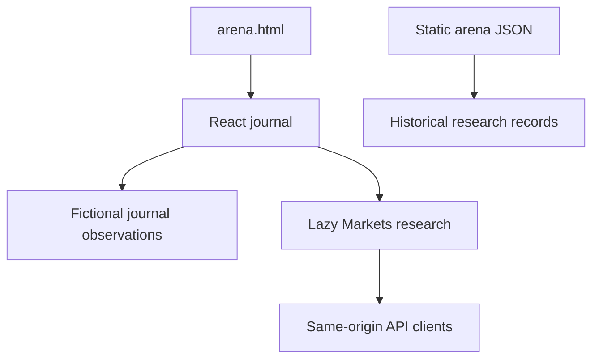

# Arena current-system audit

Observed 2026-10-12 UTC, using only the URLs supplied in this request and the resources linked from them. No prior conversations or memory were used. All HTTP checks below were read-only. No trading, analysis-job creation, cancellation, login, or deployment was attempted.

## Executive finding

The deployed page is currently a React/Vite stock-journal prototype with an independently mounted market-research feature. Its top-level prices and chart paths are explicitly fictional design data. The research feature has substantial schema-validated financial tooling in its client code, but its public market and research APIs returned HTTP 404 with `FEATURE_DISABLED` during this inspection. Static files describing an earlier AI paper-trading competition remain public, but the observed page bundles do not load that competition's logs or portfolio engine.

The primary correction is therefore to connect the visible journal to an explicit, provenance-bearing market snapshot and restore an auditable, independently persisted paper-trading workflow. A frontend refresh alone would not fix the disabled data service or revive the old competition.

## Evidence register

| ID | Public resource | Observation |
|---|---|---|
| LIVE-01 | https://feida.au/arena.html | React root `#root`; entry `/assets/arena-CJrZkVjB.js`; shared header `/lib/header-controller.js`; English/Chinese routes; no third-party analytics on the sensitive-input page. |
| LIVE-02 | https://feida.au/assets/arena-CJrZkVjB.js | Hardcoded stock and index prices, seeded sample charts, local watchlist and split preferences. No `fetch()` in the journal entry. Footer and chart text explicitly identify fictional/sample data. |
| LIVE-03 | https://feida.au/assets/Markets-CLDG8At1.js | Lazily mounted research feature. Same-origin market/research/quant/model API clients; strict source, date, currency, schema and result validation. |
| LIVE-04 | https://feida.au/api/vibe-market?instrument=US%3AMU&start=2026-09-01&end=2026-10-11 | HTTP 404; error code `FEATURE_DISABLED`; request ID `e52e1051-a8c6-4cbc-be09-ae9f1b2f9721`. |
| LIVE-05 | https://feida.au/api/vibe-research?instrument=US%3AMU&module=profile | HTTP 404; error code `FEATURE_DISABLED`; request ID `334952fd-539f-4ed4-ae5e-2629fb7c73a0`. |
| LIVE-06 | https://feida.au/api/vibe-research?instrument=US%3AMU&module=filings | HTTP 404; error code `FEATURE_DISABLED`; request ID `fd3512e6-7446-4680-845d-255769ca6ebf`. |
| LIVE-07 | https://feida.au/arena-runlog.json | 120 entries dated 2026-07-23 through 2026-08-20: 49 `done`, 70 `missed`, 1 `queued`. The final archive explicitly describes a missed decision window with no executable proposals. |
| LIVE-08 | https://feida.au/arena-predlog.json | Six prediction days, ending 2026-07-20. `updated` is 2026-07-21T08:19:03.247Z; `checkedThrough` is 2026-08-07. Numerous realized outcomes remain null. |
| LIVE-09 | https://feida.au/arena-universe.json | Version 2, updated 2026-07-23. Defined S&P 500 basket plus SPY/QQQ/SMH; constituent provenance is a dated Wikipedia extraction, not a current official index-membership feed. |
| LIVE-10 | https://feida.au/arena-quant-model.json | QF-01 v0.1.0, updated 2026-08-05; browser walk-forward model, minimum 130 observations, constrained factor portfolios. |

Raw resources, response headers, SHA-256 digests and API payloads were captured under `current-arena/` in the working environment. Selected immutable responses and the evidence manifest are included in validation/evidence for reproduction. Browser rendering was not completed in this managed environment; this report makes no claim of screenshot or real-browser interaction verification. The delivered UI has separate React SSR and jsdom interaction checks, detailed in the verification report.

## Actual deployed architecture

The static shell uses the site's shared header and footer, adaptive locale, responsive safe-area primitives and a Vite-generated asset graph. HTTP responses identify the server as Vercel. Hashed JavaScript and CSS assets use one-year immutable caching; other observed assets use revalidation. A fresh HTTP `Last-Modified` value is not evidence that the embedded financial observations are fresh.

The journal stores watchlist symbols under `afflatus:journal-watchlist:v1` and the panel split under `afflatus:journal-split:v1`. It offers candle/line presentation, range selection, chart keyboard access, resize controls, company search and add/remove watchlist actions. These are useful interaction patterns to retain, but the original source of prices and seeded chart paths must be replaced when presenting connected market observations.

## Existing research capabilities worth preserving

The Markets bundle attributes ported functionality to Vibe-Trading commit `251b094320c1f97d1486626d3618113526914d4c`. It supports a defined set of US equities/ETFs and crypto spot instruments; API capabilities are narrower than the large historical `arena-universe.json` basket.

Observed modules include daily OHLCV, technical indicators, retrospective chart patterns, Yahoo company data and analyst estimates, SEC filings and filed-cutoff financial statements, SEC 13F manager portfolios, ETF holdings, news with deterministic headline-lexicon scoring, an equity screener, crypto orderbook impact simulation, company/sector taxonomy and an optional OpenD earnings calendar. Quant/model request contracts include backtesting, listed option chains, theoretical option pricing and payoffs, DCF, comparable-company analysis and a tool catalogue.

Useful engineering properties already present:

- Instrument identities bind market, provider, venue and quote currency.
- Daily-bar responses require schema version 1, bounded history, valid chronology, source identity and explicit provenance.
- `is_realtime_quote` is required to be false for the historical-bar API; historical research must not be relabeled real-time.
- `fallback_used` is required to be false; missing upstream data is represented explicitly rather than replaced with an invented series.
- Technical results identify the upstream commit, bar count and computation basis before display sampling.
- Pattern results label themselves retrospective patterns, not executable signals.
- News sentiment is a transparent lexicon score, not evidence of an LLM analyst run.
- SEC links are constrained to HTTPS official EDGAR archive URLs by client-side validation.
- Backtest responses undergo detailed ledger consistency checks using fixed-precision/BigInt arithmetic, including cash, quantity, fees and final equity.
- Quant jobs have queued/running/complete/cancelled/failed states and abortable polling.
- Rendering primarily uses React or `textContent`; sourced text need not become raw HTML.

These checks should remain intact when integrating the financial-services workflow. The new system should reuse working research routes through an adapter and expose whether each route is enabled, rather than silently replacing them.

## API surface observed in client code

| Method | Route | Purpose and limits |
|---|---|---|
| GET | `/api/vibe-market?instrument=...&start=...&end=...` | Daily historical bars. Requested range must be 1–366 days; end bound is exclusive; maximum 400 bars. Public check returned FEATURE_DISABLED. |
| GET | `/api/vibe-research?instrument=...&module=...` | Structured research; selected modules accept cadence/cutoff/manager/begin/end. Public profile and filings checks returned FEATURE_DISABLED. |
| POST | `/api/vibe-quant` | Creates a quant job for supported modules. Observed in code only; not called during this audit. |
| GET | `/api/vibe-quant?id=...` | Polls a specific quant job. Observed in code only. |
| DELETE | `/api/vibe-quant?id=...` | Cancels a quant job. Observed in code only. |
| POST | `/api/vibe-model` | Immediate option-model, payoff and catalogue results. Observed in code only; not called. |

The client supplies `credentials: same-origin` and accepts an injected `getHeaders()` callback. That does not establish the backend's authorization policy. No service credentials were found in the inspected financial client bundles, but this was not an exhaustive secret scan. Server-side authorization, feature flags and persistence require source/configuration review by the integrating agent.

## Why the legacy records cannot be presented as a live AI league

The static QF-01 manifest describes factor weights, regime behavior, rebalance cadence, transaction costs, name caps and sector caps. The run log documents dry runs, missed windows, mark-to-market reconciliation and later non-executable research archives. The prediction log records numerical forecasts and some realized outcomes, but does not establish a continuous, current model-evaluation pipeline.

The observed journal and Markets bundles do not request these JSON files. Their presence in JSON-LD documents historical resources, not a presently running competition. A migration must keep these records as an explicitly dated archive; they must not be merged into the new prospective equity curve or used as evidence of current model performance.

## Prioritized feedback for the upgrade

| Priority | Defect or gap | Required correction |
|---|---|---|
| P0 | Main journal displays fictional observations while the desired product is a connected market dashboard. | Use one normalized snapshot contract; identify source, market timestamp, receive timestamp, quality, session and currency next to prices. |
| P0 | Public research routes are disabled. | Add capability/status reporting; implement provider configuration and controlled activation; preserve explicit failure states. |
| P0 | A stock quote could otherwise become an unqualified paper execution price. | Separate last trade, bid/ask, quote age, venue/feed status and executable-price policy; reject stale or invalid observations. |
| P0 | Existing static logs do not establish ongoing model actions or persisted positions. | Add persistent independent model accounts, a deterministic execution ledger, idempotent requests and an auditable lifecycle. |
| P0 | Research narratives and deterministic models have different evidentiary meaning. | Keep observed facts, valuation assumptions, analyst proposals, critic findings, risk decisions and simulated fills distinct in both schema and UI. |
| P1 | Research/forecast feedback has incomplete outcomes. | Track pending/realized forecasts and report sample size, coverage and calibration; withhold ranking when the sample is insufficient. |
| P1 | A dated broad universe differs from the actual enabled provider basket. | Display configured market capabilities and validate tradable symbols server-side. |
| P1 | Financial statements and index membership can change after the modeled decision cutoff. | Carry filed/as-of/retrieved timestamps and reproducible source references through research and backtests. |
| P1 | Cross-model comparisons can be distorted by different snapshots and costs. | Freeze one observation snapshot per comparison, use the same execution assumptions and record per-model costs/latency separately. |
| P2 | Useful keyboard, locale and watchlist interactions exist. | Preserve accessible navigation, bilingual labels, responsive layout and explicit errors in the connected UI. |

## Integration decision

Implement the upgrade as a scoped feature overlay on the actual Afflatus Vite/React/Vercel project. Reuse the shared site header and existing Markets research panel. Replace the fictional journal's primary dashboard with the new snapshot and paper-account UI. Add the workflow service behind `/api/arena-fsi?route=...`, keeping provider/model secrets on the server and the optional administrator token only in browser memory. Treat the explicit demo endpoint as a separate, visibly labeled demonstration; never use it as an automatic fallback for failed market calls.

