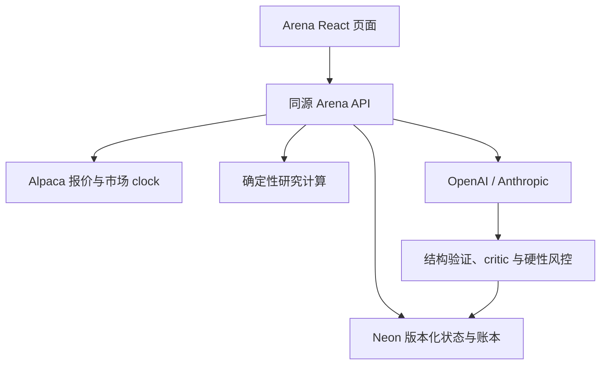

# 部署、运维与回滚

本说明针对本次实际识别的 **Afflatus / React 19 / Vite 8 / Vercel Node Functions**。它不要求迁移到另一家托管平台。

## 1. 结构与流向



API URL 为 `/api/arena-fsi?route=...`。网页只连接本站；供应商密钥在服务器。模型可产生建议，但不能绕开 core 写账。每种模式下，三个账本、订单、回合、预测、研究与审计一起通过 CAS 提交。

仓库安装器不会覆盖其它 API，不会移走历史 JSON，不会更改域名或数据库。它只修改已审计的 Arena 接入位置，新增隔离包及一条 Vercel function 配置。另一个元数据脚本更新 Arena 搜索/结构化描述，继续把旧 QF-01 分发文件保留为历史档案。

## 2. 安装和构建

在实际 Git checkout 中先创建工作分支，并查看已有修改。安装器以绝对路径指向目标：

```bash
node scripts/install-host.mjs --target /absolute/path/Afflatus
node scripts/install-host.mjs --target /absolute/path/Afflatus --apply
node scripts/patch-host-metadata.mjs --target /absolute/path/Afflatus --apply
```

主安装器保存原 entry/package/vercel 文件，元数据脚本另保存两个元数据源文件。所有版本锚点在写入前检查。若目前主分支的结构已变，应由 Codex 理解并合并同一集成位置，不能关闭检查来套旧代码。

在 Afflatus 目录：

```bash
npm install
npm run arena:fsi:check
npm run arena:fsi:test
npm run build
```

`npm run build` 包含原站 prebuild、data/site/header/CSS/i18n/OG 现有门及最终本地化 SEO 检查。若要验证部署已启用的原有研究面板，还应使用现有环境中的 `VITE_VIBE_MARKETS_ENABLED=true` 构建；这个开关只控制旧 Vibe 面板，不决定新 Arena 服务是否可用。

新增包的 `node --test` 独立运行，不替换宿主 Vitest。原 Arena/Vibe 相关已有测试也应保留。不要为了通过安装而删除现有测试或下调财务/权限校验。

## 3. 生产数据库

为当前应用配置 Neon PostgreSQL，使用服务器可访问的 `DATABASE_URL`。这是数据库连接串，不能设置成 `VITE_DATABASE_URL`，也不能提交到 Git。

新增迁移只有一张表：

```sql
CREATE TABLE IF NOT EXISTS arena_state (
  id text PRIMARY KEY,
  version bigint NOT NULL,
  document jsonb NOT NULL,
  updated_at timestamptz NOT NULL DEFAULT now()
);
```

实际迁移以 `config/001-arena-state.sql` 为准；不会 DROP、TRUNCATE 或删除现有数据。在带有真实服务端环境的 Afflatus 根目录执行：

```bash
npm run arena:fsi:migrate
npm run arena:fsi:doctor
```

`doctor` 会实际读表，打印连接是否成功以及去秘密化的配置状态。它不会打印连接串、token 或 API key，也不会调用付费模型。数据库可连接不能替代写入/回放验证；部署环境可用后应在 demo 模式完成一次写入、重试、重新读取和导出链校验，再检查 live 仍为空。

不要把 Vercel 函数的本地文件或 `/tmp` 当作生产账本。没有 DATABASE_URL 时，本包只提供有限只读状态与诊断；所有生产写入被拒绝，而不是悄悄写入不可持久的内存。

`arena:fsi:v1:demo` 与 `arena:fsi:v1:live` 是独立记录。旧 `public/arena-ledger*.json` 不被自动导入。需要迁移真实旧赛季时，先对旧记录做单独对账和时间验证；不要直接覆盖新账本。

## 4. 行情与模型

服务器配置 `ALPACA_API_KEY` / `ALPACA_SECRET_KEY`。本包访问报价和日线 REST API，以及 paper API 的**只读 `/v2/clock`**，没有任何券商订单调用。若账户不能读取权威 clock，可以展示有出处的报价，但模拟执行保持关闭。

- IEX 是单交易所报价；页面不能把它写成全美综合行情。
- SIP 的使用与公开展示需要相应订阅和许可。
- delayed_sip 始终带延迟标记，不执行订单。
- 应用将 quote 中间价用于显示，bid/ask 用于纸单执行，再加显式滑点/费用。
- 历史图拉取 `adjustment=all` 的已完成日线，保守排除当前纽约日期；不能用它冒充实时成交价。

配置 S/P/T 各自的提供商和准确模型 ID。代码支持 OpenAI Responses 与 Anthropic Messages；请求形状、拒绝与截断行为已通过模拟服务契约测试。模型真实可用性、账户限流、组织策略和费用需要在实际部署环境验证。

每个回合按配置选择最多三个 profile，每个 profile 有 analyst 和 critic 两次调用。它们共享冻结事实，但持有自己的账户上下文。critic 当前可使用同一 profile 的模型；这是第二次独立请求，不宣称是不同厂商的独立专家。

S 关注基本面与催化剂、P 关注来源明确的确定性估值、T 关注组合风险。只有一个报价且缺少所需研究证据时，策略应保持 hold。将公开来源导入 evidence，再明确发布有来源 ID 的计算 artifact，才能使最近三件计算进入下一轮研究上下文。普通网页 DCF 计算不会自动发布、不会自动交易。

模型输出有约束和结构校验；输入总长度有限，响应最大 2 MB，每次模型请求有 45 秒超时。默认每日最多 6 轮、每次最多 1,800 输出 token；实际 token 使用按提供商响应记录。没有写死可能过期的美元价格。

## 5. 环境列表与诊断

从 `.env.example` 填实际值。生产至少需要：

- `ARENA_MODE=live`。
- `DATABASE_URL` 且已迁移。
- 至少 24 字符的 `ARENA_ADMIN_TOKEN`。
- 行情两项密钥与正确 `ALPACA_DATA_FEED`。
- 三个明确模型 ID 和对应提供商密钥。
- 供应商允许公开展示后，设置 `ARENA_PUBLIC_QUOTES=true`。

不要把管理员令牌当成行情商授权，也不要把模型 API key 当成网页管理员 token。两者用途和访问范围不同。

Vercel 选择与包一致的受支持 Node 版本，建议 Node 24。安装器为新增 API 配置 `maxDuration:180`；实际项目/计划必须允许这个时限。没有长驻进程、WebSocket 或后台任意存活假设。进程在运行中终止时，回合保留 running/lease；之后的回合在 lease 到期后将其标为 interrupted，不伪造成已完成。

`GET health` 会实际读取账本表。`readyForPublicArena` 仅在 live + 持久化/可读数据库 + 管理员/行情/三个模型/公开展示配置全部具备时为 true。这个值证明配置与数据库可读，不证明模型提供商已成功认证，所以仍需实际连接验收。

## 6. 发布路径

先完成代码提交，再运行发布脚本。确保 `.vercel/project.json` 对应当前 feida.au 的项目和正确组织。不要为方便创建一个无关项目。

```bash
node integrations/arena-fsi/scripts/release-host.mjs --target .
node integrations/arena-fsi/scripts/release-host.mjs --target . --deploy
```

不带 `--deploy` 只运行验证。带该参数时，脚本执行：

1. 新模块语法/JSON 检查、测试、原站生产构建。
2. 核对现有 Vercel project link 与已提交 Git 状态。
3. `vercel deploy --prod --skip-domain --yes`，生成 production 配置的待验收部署，暂不切换现有域名。
4. GET health：版本、真实数据库读取、公开 live 准备状态。
5. GET status：确实返回非 demo 的供应商报价，公共数据未被隐藏。
6. GET `/arena.html` 与它引用的本地构建脚本：资源可读取。
7. 对 order 发送无管理员身份的空请求，确认 401；该请求不得写账。
8. 全部通过后 `vercel promote <已验证URL> --yes`。

探测不会运行付费模型，也不会发出授权的账户订单。没有把 production stage 与 production DB 相连的情况下拿真实订单来“试发布”。

如项目启用 Deployment Protection，可在执行环境中配置该项目官方提供的 `VERCEL_AUTOMATION_BYPASS_SECRET`；脚本仅将它放入 `x-vercel-protection-bypass` 请求头，不放 URL 或日志。没有可用 bypass 且 401/403 阻止验收时，脚本停止在暂存部署，不调用 promote。

原站课程 prebuild 会重建固定的 54 个未跟踪课程 HTML。脚本只豁免这些刚由构建重建的准确路径；其它未提交/未跟踪改动都阻止发布。无需把课程生成页加入 Arena 提交。

生产 key/模型认证尚需一次明确的受控回合验收。如果缺少密钥、部署权限或数据显示许可，Codex 应继续完成源码/构建/提交准备，并明确具体未满足项。不要将 demo 自动升级成“真实行情已经上线”的状态。

## 7. 可选定时运行

默认没有安装任何 cron，`ARENA_AUTORUN=false`。人工操作可以先验证报价和账本。

确认平台计划允许所需频率后，将 `config/vercel-cron.example.json` 的 crons 条目**合并**到现有 vercel.json，保留其它任务。模板每分钟调用同一 route=cron；每次先刷新报价、处理合法 pending、结算预测。只有 `ARENA_AUTORUN=true` 且市场 clock 开放时，才按 UTC 小时桶幂等运行策略。每日预算仍是硬限制。

设置至少 24 字符的 `CRON_SECRET`；Vercel cron 应发送 `Authorization: Bearer <CRON_SECRET>`。这与管理员 token 分开。不能把公开 GET status 当作 cron：status 不撮合、不运行 AI。

若平台仅支持每日 cron，则不应宣称已有分钟级挂单/预测结算。使用能够按授权频率调用该鉴权 endpoint 的调度服务，或保留手动模式，并在页面/运维说明中反映真实状态。

## 8. 归档与回滚

`POST export` 返回完整状态、SHA-256、各账本 audit/invariant 结果和所有回合冻结 context 的 hash 复核。网页导出按钮只下载当前可见快照；完整运维备份应使用鉴权 export。

每次提交的完整状态必须小于 16,000,000 bytes；达到 1,500 回合后拒绝新建 AI run。其它操作仍受自身容量和完整状态大小限制，不能静默截断财务历史。建议定期导出并备份数据库。新赛季应建立新 namespace 与新初始账本，同时保留旧导出；不要在未经校验的旧账本上清零覆盖。自动跨赛季迁移和通用数据库恢复工具不在本包范围内。

需要回退发布时，可将域名回退到上一个已经验证的部署；仅回退前端/函数不会自动撤销新数据库里的账本事件。不要用 DROP TABLE 作为应用回滚。

如尚未提交，需要恢复安装前的源文件，可按备份 receipt 还原原 entry/package/vercel，删除新增 API 的对应挂载，然后运行 `npm install` 更新 lock。元数据恢复：

```bash
cp integrations/arena-fsi-install-backup/metadata/src/config/siteManifest.js src/config/siteManifest.js
cp integrations/arena-fsi-install-backup/metadata/scripts/route-seo.mjs scripts/route-seo.mjs
node scripts/site-manifest.mjs --write
node scripts/site-manifest.mjs --check
```

已提交时优先使用正常的 revert 提交，使改动与回滚可审计。不要删除数据库状态、生产导出或用户已有文件来使工作树看起来干净。

## 9. 官方技术资料

本次核对日期：2026-10-12。实际平台限制以接手部署时的项目与官方文档为准。

- [Alpaca stock snapshots](https://docs.alpaca.markets/reference/stocksnapshots-1)
- [Alpaca historical stock bars](https://docs.alpaca.markets/reference/stockbars-1)
- [Alpaca market clock](https://docs.alpaca.markets/reference/getclock-1)
- [OpenAI Structured Outputs](https://developers.openai.com/api/docs/guides/structured-outputs)
- [Anthropic Messages API](https://platform.claude.com/docs/en/api/messages/create)
- [Neon serverless driver](https://neon.com/docs/serverless/serverless-driver)
- [Vercel Node.js runtime](https://vercel.com/docs/functions/runtimes/node-js)
- [Vercel CLI deploy](https://vercel.com/docs/cli/deploy)
- [Vercel promote](https://vercel.com/docs/cli/promote)
- [Vercel automation protection bypass](https://vercel.com/docs/deployment-protection/methods-to-bypass-deployment-protection/protection-bypass-automation)
- [Vercel cron jobs](https://vercel.com/docs/cron-jobs/manage-cron-jobs)

